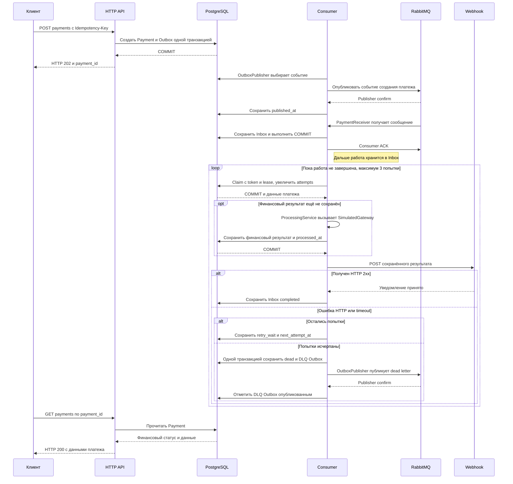

# Payment Resolver

HTTP API принимает платёж, один consumer обрабатывает его в фоне и отправляет
результат на webhook. Хранилище — PostgreSQL, транспорт — RabbitMQ.
Шлюз эмулируется: реальных списаний нет.

## Запуск

Нужны Docker Engine и Docker Compose v2. Существующую `.env` не перезаписывайте:

```bash
test -e .env || cp .env.example .env
docker compose up -d --build --wait
```

API ждёт PostgreSQL, выполняет `alembic upgrade head` и запускает Uvicorn.
После готовности API, PostgreSQL и RabbitMQ стартует consumer. Readiness API —
TCP-порт после миграций; открытых health/admin-маршрутов нет.
Для нескольких production-реплик миграции нужно вынести в отдельный release job.

Порты опубликованы только на `127.0.0.1`:

| Сервис | Порт |
|---|---|
| API | 8000 |
| PostgreSQL | 5432 |
| RabbitMQ / management UI | 5672 / [15672](http://127.0.0.1:15672) |
| Тестовый webhook receiver | 8081, только профиль `test` |

Демонстрационный API-ключ — `local-development-key`; пользователь PostgreSQL/RabbitMQ —
`payments`, пароль — `payments-dev-password`. Изменение bootstrap-паролей в `.env`
не меняет пользователей в существующих volumes.

БД и брокер сохраняют данные в volumes. Не удаляйте их для исправления авторизации.
Не меняйте hostname/nodename RabbitMQ (`rabbitmq`) без переноса данных: от него зависит
каталог узла. Один RabbitMQ-контейнер не обеспечивает HA.

## HTTP

Swagger UI: [http://127.0.0.1:8000/docs](http://127.0.0.1:8000/docs).
Страница и [OpenAPI-схема](http://127.0.0.1:8000/openapi.json) доступны без ключа;
платёжные маршруты по-прежнему требуют авторизацию. Нажмите **Authorize** и введите
`local-development-key` (или свой `API_KEY` из `.env`). Затем используйте **Try it out**.
Для POST укажите новый `Idempotency-Key` и тело из примера ниже. ReDoc выключен.

Поднимите получатель webhook и создайте платёж:

```bash
docker compose --profile test up -d --build --wait webhook

curl -i http://127.0.0.1:8000/api/v1/payments \
  -H 'X-API-Key: local-development-key' \
  -H 'Idempotency-Key: example-payment-1' \
  -H 'Content-Type: application/json' \
  -d '{"amount":"100.25","currency":"RUB","description":"","metadata":{},"webhook_url":"http://webhook:8081/ok"}'

curl -i http://127.0.0.1:8000/api/v1/payments/PAYMENT_UUID \
  -H 'X-API-Key: local-development-key'
```

Оба маршрута требуют `X-API-Key`. POST дополнительно требует `Idempotency-Key`
длиной 1–255 символов, не состоящий только из пробельных символов.
Все пять полей тела обязательны; дополнительные поля запрещены.

| Поле | Ограничение |
|---|---|
| `amount` | Положительная десятичная строка: до 16 цифр целой части и двух дробных. Без знака, экспоненты, ведущих нулей и округления. JSON-число не принимается. |
| `currency` | `RUB`, `USD`, `EUR` |
| `description` | Строка, в том числе пустая; не null |
| `metadata` | JSON-объект; `{}` допустим, NaN/Infinity на любой глубине — нет |
| `webhook_url` | HTTP(S) URL без userinfo и fragment; точный origin должен входить в allowlist |

POST возвращает `202` с `payment_id`, `status`, `created_at` после commit.
GET возвращает сохранённые поля платежа, включая финансовый `status` и `processed_at`;
статусы Inbox и attempts наружу не выдаются. Сумма в ответах всегда с двумя дробными знаками.

Повтор ключа с теми же нормализованными полями возвращает прежний платёж и его
текущий статус без новой работы. Ключ чувствителен к регистру и не нормализуется.
Суммы `"100"`, `"100.0"`, `"100.00"` эквивалентны; порядок ключей metadata не важен.
URL нормализуется Pydantic.

| HTTP | Причина |
|---|---|
| `401` | Нет API-ключа или он неверный |
| `404` | Платёж с корректным UUID не найден |
| `409` | Тот же Idempotency-Key использован с другим содержимым |
| `422` | Невалидное тело, UUID, ключ или URL |
| `503` | Хранилище недоступно до успешного commit |

## Обработка платежа

`Consumer` на диаграмме — один процесс с receiver, Outbox publisher и Inbox executor.
Публикация и приём идут параллельно; показан один допустимый порядок.



API может принимать платежи без доступного RabbitMQ: работа остаётся в Outbox.
Publisher ждёт успешной маршрутизации и Basic.Ack, receiver подтверждает сообщение
после commit Inbox. Транспортные дубликаты не создают новую работу.

Шлюз ждёт 2–5 секунд и даёт стабильный исход по payment UUID: около 90% успехов и
10% отказов между случайными ID. Финансовый переход один: `pending` → `succeeded`
или `failed`. Результат и `processed_at` больше не меняются.

Три начатые попытки охватывают весь сценарий. После сохранения финансового результата
повторяется только webhook. Retry использует экспоненциальную задержку с jitter; просроченный
claim восстанавливается, но начатая попытка уже израсходована. После третьей ошибки
одной транзакцией сохраняются Inbox.dead и DLQ Outbox. Неизвестный финансовый
результат остаётся `pending`, известный не меняется. Outbox повторяет публикацию
без трёхпопыточного лимита; published-записи сохраняются.

### Webhook и RabbitMQ

Webhook — POST JSON с полями `event_id`, `payment_id`, `status`, `amount`, `currency`,
`created_at`, `processed_at`. Event ID равен `uuid5(payment_id, "payment.result")`;
тело и timestamps одинаковы при повторе. Description, metadata, API-ключ и клиентский
Idempotency-Key не передаются. Любой `2xx` подтверждает доставку; остальные статусы,
сеть и timeout расходуют попытку. Redirects и внутренние HTTP retries выключены,
Retry-After игнорируется. Connect timeout — 2 секунды, общий deadline — 5.

Allowlist проверяет точное совпадение scheme, host и effective port при создании
и перед отправкой. Администратору и DNS доверяем; это не SSRF/network sandbox.
Доставка **at least once**: получателю нужно дедуплицировать event_id.
DLQ не доказывает, что предыдущий webhook не был принят.

В UI RabbitMQ ничего создавать не нужно: `modules/messaging/broker.py` объявляет
топологию при старте consumer. Exchanges — durable direct, очереди — durable quorum:

| Exchange | Routing key / очередь |
|---|---|
| `payments` | `payments.new` |
| `payments.dlx` | `payments.dlq` |

Публикации persistent и mandatory, ACK ручной, prefetch=1. Delivery limit рабочей
очереди отключён: retry выполняет Inbox. У DLQ нет subscriber; приложение публикует
в неё само, без автоматического broker DLX retry. Dead letter содержит исходный
`event_id`, `payment_id`, `attempts=3`, `payment_status`, `error_code`, `last_http_status`,
`failed_at`. Невалидный вход передаётся в DLQ до ACK источника как `invalid_message`
с base64-префиксом до 4096 bytes, исходным размером и признаком усечения.

## Код и настройки

Пути относительно `payment_resolver/`:

| Путь | Ответственность |
|---|---|
| `core/` | Сущности, DTO, инварианты, порты |
| `api/`, `app.py` | HTTP, авторизация, сборка API |
| `modules/payments/logic.py` | Создание/чтение и обработка платежа |
| `modules/database/` | Модели в `models/` и SQL-репозитории в `repositories/` по сущностям, Unit of Work |
| `modules/messaging/` | AMQP-топология, publisher, receiver |
| `modules/processing/runtime.py`, `consumer.py` | Runtime consumer и CLI-вход |
| `modules/gateway/`, `modules/webhooks/` | Эмулятор шлюза и HTTP-доставка |

Общий префикс `/api/v1` задаётся в `app.py`, а `/payments` — в роутере ресурса.

`pydantic-settings` читает настройки в порядке: явные аргументы Settings > environment >
`.env` рабочего каталога > defaults. Имена чувствительны к регистру; `.env.example` сам
не загружается. Обязательны `API_KEY` (непустой ASCII-секрет), `DATABASE_URL`,
`RABBITMQ_URL`, `WEBHOOK_ALLOWED_ORIGINS` (непустой JSON-массив точных origins).
`RETRY_BASE_SECONDS` по умолчанию 5, строго положителен. Ошибка конфигурации останавливает
запуск до открытия ресурсов. `.env` исключён из Git и Docker build context.

Для запуска на хосте нужны Python 3.12 и uv 0.11.25. Замените контейнерные адреса
`postgres`, `rabbitmq`, `webhook` на доступные с хоста и разрешите origin получателя.
Примените миграции; API и consumer запускайте в разных терминалах:

```bash
uv sync --python 3.12 --frozen
uv run --frozen alembic upgrade head
uv run --frozen uvicorn payment_resolver.app:create_app --factory
uv run --frozen python -m payment_resolver.consumer
```

SIGTERM/SIGINT прекращают взятие новой работы. На текущие действия отведено 25 секунд,
затем consumer отменяет их и закрывает ресурсы. В Compose stop grace period — 35 секунд.
Неожиданный сбой фоновой задачи завершает весь consumer ненулевым кодом.

### Логи

| Переменная | Значения | По умолчанию |
|---|---|---|
| `APP_ENV` | `development`, `production` | `development` |
| `LOG_LEVEL` | `DEBUG`, `INFO`, `WARNING`, `ERROR`, `CRITICAL` | `INFO` |
| `LOG_FORMAT` | `text`, `json` | text в development, JSON в production |

Вывод в stderr, одна строка на событие. INFO — lifecycle и бизнес-переходы после commit;
WARNING — retry и первый сбой инфраструктуры; ERROR — dead и неожиданные ошибки.
Повтор POST не добавляет `payment.accepted`; повторяющиеся сбои не дают WARNING
на каждый poll. HTTP access logs и обычные HTTPX/FastStream INFO выключены.

Для поиска есть `event`, `payment_id`, `event_id`, `attempt`, `error_code`.
Ключи, URL/query, description, metadata и тела запросов не выводятся.
JSON содержит тип исключения без его текста; dev text добавляет места вызова без
исходного кода. Alembic сохраняет собственный CLI-формат.

```bash
docker compose logs -f api consumer
```

## Проверки

```bash
uv run --frozen pre-commit install
uv run --frozen pre-commit run --all-files
uv run --frozen ruff check .
uv run --frozen ruff format --check .
uv run --frozen mypy
uv run --frozen pytest tests/unit -q

docker compose --profile test up -d --build --wait postgres rabbitmq webhook api consumer
docker compose --profile test run --rm tests \
  uv run --frozen pytest tests/unit tests/integration -q
```

Hook форматирует и lint-проверяет staged Python-файлы, строго проверяет приложение
и миграции через mypy, запускает unit-тесты. Новые файлы добавьте в Git или передайте
через `pre-commit run --files ...`.

Интеграция использует настоящие PostgreSQL/RabbitMQ и HTTP receiver, отдельные БД/vhost
`test_<uuid>`. Удаляются только собственные ресурсы теста. Нужны CREATE DATABASE и
RabbitMQ management administrator. Compose передаёт TEST_*; для запуска на хосте
задайте `TEST_POSTGRES_ADMIN_DSN`, `TEST_RABBITMQ_MANAGEMENT_URL`, `TEST_RABBITMQ_USERNAME`,
`TEST_RABBITMQ_PASSWORD`, при внешнем receiver — `TEST_WEBHOOK_URL`.

Тестовый receiver: `/ok` — 204, `/fail` — 503, `/flaky` — 503/503/204 на событие,
`/timeout` сохраняет receipt и ждёт 6 секунд, `/redirect` — 307 на `/redirect-target`.
GET `/receipts` показывает обращения. В production API этих маршрутов нет.

[CI](.github/workflows/ci.yml) на push/pull_request проверяет lint/format/types/unit,
собирает образы, запускает сервисы и интеграцию. При ошибке выводит последние 200 строк
логов сервисов; при завершении останавливает CI-окружение без удаления volumes.
GitHub-hosted запуск пока не проверен; команды выполнялись локально.